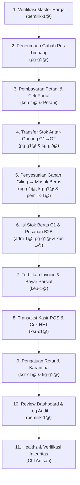

# 📖 REGRESI BABAK B — CERITA SATU MINGGU DI SiLeuit.id
**Panduan Pengujian Regresi Naratif & Checklist 28 Test Case (E2E Manual & Otomasi)**

---

## 📌 Ringkasan Eksekutif & Lingkungan Pengujian

Dokumen ini disusun sebagai panduan lengkap pengujian regresi (*Babak B*) platform rantai pasok gabah dan beras **SiLeuit.id**. Panduan ini menggabungkan narasi alur operasional mingguan yang nyata (*Adegan 1 s.d. 14*) dengan matriks teknis formal: **Checklist B.1 (19 Test Case Prioritas 1 / P1)**, **Checklist B.2 (9 Test Case Prioritas 2 / P2)**, dan **Checklist B.3 (Satu Sesi Siklus Utuh K.7 Butir 1)**.

Semua data pengujian (nama pihak, nomor telepon, akun pengguna, ID kontrak, plafon piutang, dan harga bertanggal) diselaraskan **100% persis dengan data awal di seeder aplikasi** (`database/seeders/DatabaseSeeder.php`).

### ⚙️ Prasyarat & Lingkungan Dev:
- **URL Aplikasi Utama**: [http://127.0.0.1:8000](http://127.0.0.1:8000)
- **Portal Petani Mitra**: [http://127.0.0.1:8000/login/petani](http://127.0.0.1:8000/login/petani)
- **Panel Administrasi Filament**: [http://127.0.0.1:8000/admin](http://127.0.0.1:8000/admin)
- **Health Check Endpoint**: [http://127.0.0.1:8000/healthz](http://127.0.0.1:8000/healthz)
- **Basis Data**: MySQL 8.x (InnoDb, row locking, trigger append-only audit & ledger).
- **Object Storage**: MinIO S3 (`http://127.0.0.1:9000`, bucket `sileuit-dev`).
- **Cache & Antrean**: Redis in-memory.

---

## 👥 Tabel Pemeran Cerita & Kredensial Database Seeder

Tabel berikut memetakan tokoh dalam cerita fiksi operasional dengan entitas akun dan data yang tersimpan di basis data aplikasi (`database/seeders/DatabaseSeeder.php`):

| Tokoh Cerita | Nama Entitas di Database | Akun Login (Email / HP) | Password / PIN | Peran (RBAC) | Lokasi Tugas | Keterangan & Referensi Seeder |
| :--- | :--- | :--- | :--- | :--- | :--- | :--- |
| **Pa Danu** | Petani Contoh A | HP: `8111111001`<br>*(DB: `+628111111001`)* | PIN: `123456` | `PETANI` | - | Petani Mitra `P-001`, Kelompok Tani Makmur. Kontrak `k1` (5.000 kg), Rencana Panen `1.000 kg` (12 Nov 2026). Desa Sukamaju (0,5 Ha). Login di `/login/petani`. |
| **Pa Dedi** | Petani Contoh B | HP: `8111111002`<br>*(DB: `+628111111002`)* | PIN: `123456` | `PETANI` | - | Petani Mitra `P-002`, Kelompok Tani Sejahtera. Kontrak `k2` (3.000 kg), Rencana Panen `800 kg` (19 Nov 2026). Desa Cibogo (0,75 Ha). Login di `/login/petani`. |
| **Ujang** | Petugas Gudang G1 | `pg-g1@sileuit.id` | `Sileuit#2026` | `PETUGAS_GUDANG` | Gudang 1 (`G1`) | Petugas pos timbang dan inspeksi mutu awal. Mengoperasikan wizard penerimaan, transfer barang, dan pengajuan penyesuaian susut. |
| **Pak Asep** | Kepala Gudang G1 | `kg-g1@sileuit.id` | `Sileuit#2026` | `KEPALA_GUDANG` | Gudang 1 (`G1`) | Supervisor operasional G1. Menyetujui deviasi berat timbang >1%, menyetujui mutasi penyesuaian stok, override alokasi lot expired, disposisi retur. |
| **Rina** | Kepala Gudang G2 | `kg-g2@sileuit.id` | `Sileuit#2026` | `KEPALA_GUDANG` | Gudang 2 (`G2`) | Supervisor operasional G2. Penerima transfer gabah antar-gudang (G1 → G2) dan pencatat discrepancy fisik. |
| **Mbak Sari** | Kasir Cabang 1 | `ksr-c1@sileuit.id` | `Sileuit#2026` | `KASIR` | Cabang 1 (`C1`) | Petugas kasir toko ritel/cabang. Melayani penjualan POS, validasi batas HET beras, anti-stok negatif, pengajuan retur barang rusak. |
| **Bu Tuti** | Keuangan Contoh | `keu-1@sileuit.id` | `Sileuit#2026` | `KEUANGAN` | Kantor Pusat (Global) | Staf administrasi keuangan. Pencatatan pembayaran gabah petani (idempotent), penerbitan faktur B2B, penagihan AR FIFO, backup & restore database. |
| **Pak Omang** | Pemilik Contoh | `pemilik-1@sileuit.id` | `Sileuit#2026` | `PEMILIK` | Eksekutif (Global) | Direktur/Owner SiLeuit.id. Menyetujui daftar harga hulu, memantau dashboard eksekutif, menginspeksi log audit tamper-evident (`AKSES_DITOLAK`). |
| **Mbak Admin** | Admin Contoh | `adm-1@sileuit.id` | `Sileuit#2026` | `ADMIN` | Kantor Pusat (Global) | Administrator operasional. Membuat pesanan retail B2B, mengelola alokasi FEFO dan backorder, mengatur konfigurasi penegakan HET di panel admin. |
| **Kang Ucin** | Kurir Contoh | `kur-1@sileuit.id` | `Sileuit#2026` | `KURIR` | Gudang 1 (`G1`) | Tim logistik distribusi. Mengirim transfer antar-gudang dan pengiriman pesanan B2B dengan Surat Jalan, konfirmasi serah terima (POD). |
| **Warung Bu Ijah** | Retail Contoh Satu | `retail-contoh-satu@mitra.sileuit.id`<br>HP: `+628222222001` | `Sileuit#2026` | `MITRA_B2B` | Mitra R-01 | Mitra retail pembeli beras grosir. Plafon kredit Rp15.000.000, termin pembayaran 14 hari. |
| **Toko Beras Berkah** | Retail Contoh Dua | `retail-contoh-dua@mitra.sileuit.id`<br>HP: `+628222222002` | `Sileuit#2026` | `MITRA_B2B` | Mitra R-02 | Mitra retail alternatif. Plafon kredit Rp10.000.000, termin pembayaran 7 hari. |

---

## 🎬 Rekonstruksi Naratif: Dari Nol Hingga Epilog (Adegan 0 s.d. 14)

Setiap adegan di bawah ini menggambarkan alur kerja nyata di lapangan—dimulai dari **nol (persiapan awal musim tanam di panel admin)** sebelum truk gabah pertama masuk gudang—disertai aksi pengguna langkah-demi-langkah, aturan bisnis (*Business Rules / BR*), mekanisme teknis, dan titik verifikasi (*Checkpoint*).

---

### Adegan 0 — Awal Musim Tanam: Memulai dari Nol Sebelum Pos Timbang Dibuka
*Sebelum Ujang bisa memilih nama Pa Danu dan perkiraan panen `1.000 kg` di pos timbang, sistem harus terlebih dahulu diisi data lokasi, akun pengelola, mitra petani & warung, kontrak tanam, jadwal rencana panen, dan daftar harga yang disetujui Pemilik.*

> **Catatan Lingkungan Uji**: Langkah 0.1 s.d. 0.4 di bawah ini secara otomatis terisi saat menjalankan `php artisan migrate --seed` (`DatabaseSeeder`, `HetConfigSeeder`, `StokAwalSeeder`, `InvoiceBaselineSeeder`). Bagian ini menjelaskan **asal-usul setiap data tersebut** dan cara membuatnya secara manual dari nol lewat Panel Admin (`/admin`).

- **Pemeran**: Mbak Admin (`adm-1@sileuit.id`), Staf Pengadaan (`pengadaan-1@sileuit.id`), & Pak Omang (`pemilik-1@sileuit.id`).
- **Langkah-langkah Dari Nol di Panel Admin (`/admin`)**:
  1. **0.1 — Mendirikan Gudang, Cabang, & Akun Pengelola** ([/admin/locations](http://127.0.0.1:8000/admin/locations), [/admin/users](http://127.0.0.1:8000/admin/users)):
     - Admin mendaftarkan 3 gudang sentra (`G1`, `G2`, `G3`) dan 2 toko cabang ritel (`C1`, `C2`).
     - Admin membuat akun staf lapangan dan mengikat cakupan lokasi tugas masing-masing (misal: Ujang & Pak Asep di `G1`, Rina di `G2`, Mbak Sari di `C1`, Kang Ucin di `G1`).
  2. **0.2 — Mendaftarkan Petani Mitra, Lahan, & Warung Retail B2B** ([/admin/partners](http://127.0.0.1:8000/admin/partners)):
     - Pengadaan mendaftarkan **Pa Danu** (`Petani Contoh A`, HP `+628111111001`, PIN `123456`, Desa Sukamaju 0,5 Ha) dan **Pa Dedi** (`Petani Contoh B`, HP `+628111111002`, PIN `123456`, Desa Cibogo 0,75 Ha).
     - Admin mendaftarkan **Warung Bu Ijah** (`Retail Contoh Satu`, limit kredit Rp15.000.000, termin 14 hari).
  3. **0.3 — Menyepakati Standar Mutu, Kontrak Tanam, & Rencana Panen** ([/admin/standard-packages](http://127.0.0.1:8000/admin/standard-packages), [/admin/contracts](http://127.0.0.1:8000/admin/contracts), [/admin/harvest-plans](http://127.0.0.1:8000/admin/harvest-plans)):
     - Staf Pengadaan membuat `Paket Standar Gabah Jabar 2026` (kadar air maks Grade A `14%`, Grade B `16%`, Grade C `18%`).
     - Pengadaan membuat **Kontrak Aktif** untuk Pa Danu (`k1`, musim `2026/2027`, estimasi `5.000 kg`) dan Pa Dedi (`k2`, estimasi `3.000 kg`). Jika masih berstatus draft, Pemilik **Pak Omang** menyetujuinya.
     - **Mengapa di Adegan 1 muncul pilihan Rencana Panen `1.000 kg`?** Karena Pengadaan lebih dulu menginput jadwal **Rencana Panen (`HarvestPlan`)** di [/admin/harvest-plans](http://127.0.0.1:8000/admin/harvest-plans): Pa Danu dijadwalkan setor perdana **`1.000 kg`** tanggal `12 Nov 2026` (`RENCANA`), dan Pa Dedi **`800 kg`** tanggal `19 Nov 2026`. Angka inilah yang otomatis ditarik wizard timbang sebagai **patokan toleransi timbangan jujur ($\pm 1\%$)**! *(Bila ada kiriman panen susulan dengan tanggal/kuota baru, tambahkan baris Rencana Panen baru di menu ini terlebih dahulu).*
  4. **0.4 — Menetapkan & Mengunci Daftar Harga Hulu serta Batas HET Hilir** ([/admin/price-list-items](http://127.0.0.1:8000/admin/price-list-items), [/admin/het-configs](http://127.0.0.1:8000/admin/het-configs)):
     - Pengadaan mengusulkan harga beli **GABAH** bertanggal mulai `1 Nov 2026`: Grade A `Rp6.800/kg`, Grade B `Rp6.500/kg`, Grade C `Rp6.200/kg`.
     - **Pak Omang** (`pemilik-1@sileuit.id`) mengklik tombol **Setujui** pada ketiga harga tersebut agar resmi terkunci dan tidak bisa diubah di pos timbang (`BR-01`).
     - Admin mengaktifkan **Konfigurasi HET** untuk **BERAS** (`Rp13.500/kg`, mode `BLOKIR`).
- **Checkpoint Kesiapan (Sebelum Adegan 1)**:
  - Pa Danu punya Kontrak `k1` aktif dan Rencana Panen `1.000 kg`.
  - Harga GABAH Grade A, B, C sudah berstatus disetujui oleh Pemilik (`pemilik-1`).
  - Laman utama `/` ([http://127.0.0.1:8000](http://127.0.0.1:8000)) menampilkan landing page profil lumbung & portal masuk staf maupun petani.

---

### Adegan 1 — Pagi di Pos Timbang (TC-01)
*Pa Danu datang membawa gabah kontraknya. Ujang membuka wizard penerimaan di pos timbang Gudang G1.*

- **Pemeran**: Ujang (`pg-g1@sileuit.id` / `Sileuit#2026`).
- **Test Case Terkait**: `TC-01` (Prioritas 1).
- **Langkah-langkah Demo**:
  1. Login ke aplikasi sebagai **Ujang** di [http://127.0.0.1:8000/login](http://127.0.0.1:8000/login).
  2. Buka menu **Penerimaan Gabah** ([/app/penerimaan](http://127.0.0.1:8000/app/penerimaan)), lalu klik tombol **+ Terima Gabah Baru** ([/app/terima](http://127.0.0.1:8000/app/terima)).
  3. **Langkah 1 (Kontrak & Petani)**:
     - Pilih Petani: `Petani Contoh A` (Pa Danu - `P-001`).
     - Sistem otomatis menampilkan nomor kontrak aktif `k1` (kuota 5.000 kg, rencana panen 1.000 kg).
     - Klik **Lanjut ke Penimbangan**.
  4. **Langkah 2 (Timbangan Bruto & Tara)**:
     - Masukkan Bruto: `1050` kg.
     - Masukkan Tara: `50` kg.
     - Sistem secara otomatis menghitung Berat Netto: **1.000 kg**.
     - Perhatikan banner toleransi: muncul badge hijau *"Sesuai Rencana Panen (Deviasi 0.0%)"*.
     - Klik **Lanjut ke Uji Mutu**.
  5. **Langkah 3 (Inspeksi Mutu SNI & Foto Bukti)**:
     - Komoditas: `GABAH`.
     - Varietas: `Ciherang`.
     - Kadar Air: `13.5` % (gunakan titik atau koma).
     - Butir Hampa: `2.0` %.
     - Butir Patah: `3.0` %.
     - Unggah Foto Timbangan / Sampel Gabah.
     - Klik **Lanjut ke Konfirmasi**.
  6. **Langkah 4 (Review, Penguncian Harga & Konfirmasi)**:
     - Sistem mengevaluasi kadar air 13,5% $\le 14\%$ $\rightarrow$ **Grade A**.
     - Sistem menjalankan `PriceResolver` bertanggal: mengunci harga resmi Grade A per 1 Nov 2026 = **Rp6.800 / kg**.
     - Nilai pembayaran terkunci otomatis: $1.000 \times \text{Rp}6.800 = \textbf{Rp6.800.000}$.
     - Klik tombol **Konfirmasi Penerimaan**.
- **Logika Bisnis & Validasi Sistem**:
  - `BR-01`: Harga gabah dihitung deterministik berdasarkan hasil uji mutu objektif dan daftar harga bertanggal yang disetujui Pemilik. Petugas timbang tidak bisa mengedit harga per kg secara manual.
  - Sistem membuat dokumen penerimaan dengan nomor urut bebas tabrakan (`GRN-G1-...`), membuat baris lot baru (`LOT-G1-2611...`), mencatat mutasi stok masuk (`TERIMA` +1.000 kg), dan menulis jejak audit.
- **Checkpoint Verifikasi**:
  - Status dokumen penerimaan: `CONFIRMED`.
  - Cek menu Stok ([/app/stok](http://127.0.0.1:8000/app/stok)): Lot baru muncul dengan saldo 1.000 kg.
  - Cek Kartu Stok ([/app/stok/{lotId}](http://127.0.0.1:8000/app/stok/1)): Tercatat mutasi `TERIMA` +1.000 kg.
  - Cek Log Audit ([/app/audit](http://127.0.0.1:8000/app/audit)): Tercatat aksi `PENERIMAAN_KONFIRMASI` oleh `pg-g1@sileuit.id`.

---

### Adegan 2 — Timbangan yang Jujur (TC-02 & TC-03)
*Kiriman kedua Pa Danu berada dalam toleransi wajar, namun kiriman ketiga susut tajam 10% dan memerlukan persetujuan Kepala Gudang.*

- **Pemeran**: Ujang (`pg-g1@sileuit.id`) & Pak Asep (`kg-g1@sileuit.id`).
- **Test Case Terkait**: `TC-02` (Prioritas 2) dan `TC-03` (Prioritas 1).
- **Skenario A — Toleransi Otomatis (TC-02)**:
  1. Ujang membuka wizard penerimaan untuk Pa Danu (`Petani Contoh A`).
  2. Input Bruto `1045` kg, Tara `50` kg $\rightarrow$ Netto **995 kg** (Deviasi $-0,5\%$ terhadap rencana 1.000 kg).
  3. Sistem memunculkan **Banner Hijau: "Dalam Toleransi Wajar (±1%)"**.
  4. Isi mutu: Kadar air `13.8` % (Grade A), unggah foto, lalu konfirmasi.
  5. Hasil: Penerimaan lolos langsung tanpa memerlukan approval supervisor (`CONFIRMED`).
- **Skenario B — Deviasi Tajam & Otorisasi Supervisor (TC-03)**:
  1. Pada pengiriman berikutnya, Pa Danu membawa gabah dengan Bruto `950` kg, Tara `50` kg $\rightarrow$ Netto **900 kg** (Deviasi $-10\%$).
  2. Sistem mendeteksi selisih $>1\%$ dan menampilkan **Banner Kuning: "Deviasi Melebihi Toleransi Rencana Panen (-10%)"**.
  3. Form mewajibkan Ujang mengisi catatan alasan deviasi: ketik *"Sebagian gabah tercecer di truk pengangkut akibat terpal bocor"*.
  4. Tombol aksi berubah dari "Konfirmasi Langsung" menjadi **"Kirim untuk Persetujuan Supervisor"**.
  5. Ujang mengklik tombol kirim persetujuan $\rightarrow$ Status dokumen menjadi `MENUNGGU_PERSETUJUAN`.
  6. **Pengecekan Stok**: Buka menu [/app/stok](http://127.0.0.1:8000/app/stok). Saldo stok **TIDAK BERTAMBAH** (angka tetap, lot belum terbit).
  7. **Persetujuan oleh Pak Asep**:
     - Logout Ujang, lalu login sebagai **Pak Asep** (`kg-g1@sileuit.id`).
     - Buka dokumen penerimaan tersebut di menu Penerimaan.
     - Di kotak persetujuan selisih, Pak Asep membaca catatan Ujang, menulis catatan approval: *"Susut transportasi wajar dan diverifikasi fisik"*, lalu klik **Setujui Deviasi Timbang**.
  8. Ujang (atau Pak Asep) menekan tombol **Konfirmasi Penerimaan Akhir**.
- **Checkpoint Verifikasi**:
  - Sebelum persetujuan: Dokumen `MENUNGGU_PERSETUJUAN`, saldo gudang tidak bertambah.
  - Setelah persetujuan: Status menjadi `CONFIRMED`, lot terbit dengan kuantitas 900 kg.
  - Audit log mencatat: `SELISIH_DISETUJUI` disertai catatan alasan supervisor.

---

### Adegan 3 — Gabah Basah Pa Dedi (TC-04 + Portal Petani)
*Pa Dedi membawa gabah yang dipanen tergesa-gesa saat hujan lebat dengan kadar air 22%. Sistem menolak tegas sesuai batas aman SNI dan alasannya terlihat transparan di portal petani.*

- **Pemeran**: Ujang (`pg-g1@sileuit.id`) & Pa Dedi (`8111111002` / PIN `123456`).
- **Test Case Terkait**: `TC-04` (Prioritas 1) dan Aturan Bisnis `BR-06`.
- **Langkah-langkah Demo**:
  1. Ujang login dan membuka wizard penerimaan baru.
  2. Pilih Petani: `Petani Contoh B` (Pa Dedi - `P-002`, Kontrak `k2`).
  3. Masukkan timbangan: Bruto `850` kg, Tara `50` kg (Netto 800 kg).
  4. Pada langkah mutu, masukkan Kadar Air: `22.0` %.
  5. **Evaluasi Sistem**:
     - Standar mutu beras/gabah menetapkan batas maksimal Grade C adalah kadar air 18%.
     - Kadar air 22% berada di luar rentang SNI. Sistem **TIDAK MEMBERIKAN GRADE** (Grade kosong / `TIDAK_LOLOS`).
     - Sistem memunculkan panel penolakan wajib: Tombol konfirmasi normal dinonaktifkan, muncul opsi **Tolak Penerimaan** atau **Karantina**.
  6. Ujang memilih opsi **Tolak Penerimaan** dan wajib menulis alasan penolakan: *"Kadar air 22.0% melebihi ambang batas maksimal penerimaan (18.0%). Risiko busuk tinggi."*
  7. Klik **Proses Penolakan**. Status dokumen menjadi `REJECTED`.
  8. **Verifikasi Stok**: Tidak ada lot baru yang dibuat, mutasi stok ledger 0.
  9. **Transparansi di Portal Petani (BR-06)**:
     - Buka browser baru (atau tab incognito) ke [http://127.0.0.1:8000/login/petani](http://127.0.0.1:8000/login/petani).
     - Masukkan Nomor HP: `8111111002` (Pa Dedi) dan PIN: `123456`.
     - Masuk ke dashboard portal petani.
     - Perhatikan riwayat penerimaan terbaru: Status tampil dengan badge merah mencolok **"DITOLAK / TIDAK DITERIMA"**.
     - Klik detail penerimaan: Alasan penolakan dari Ujang (*"Kadar air 22.0% melebihi ambang batas..."*) tertulis jelas dan transparan.
- **Checkpoint Verifikasi**:
  - Dokumen penerimaan berstatus `REJECTED`.
  - Tidak ada penambahan baris pada tabel `lots` maupun `stock_ledgers`.
  - Portal Petani menampilkan status penolakan beserta alasan lengkap.
  - Audit log mencatat aktivitas `PENERIMAAN_DITOLAK`.

---

### Adegan 4 — Mutu Menentukan Rupiah (TC-19)
*Pa Danu mengirimkan gabah hasil panen petak kedua dengan kadar air 15%. Sistem secara otomatis menurunkan kelas mutu ke Grade B tanpa intervensi manual.*

- **Pemeran**: Ujang (`pg-g1@sileuit.id`) & Pa Danu (`8111111001` / PIN `123456`).
- **Test Case Terkait**: `TC-19` (Prioritas 1).
- **Langkah-langkah Demo**:
  1. Ujang membuka wizard penerimaan untuk `Petani Contoh A` (Pa Danu).
  2. Input timbangan: Bruto `1050` kg, Tara `50` kg (Netto 1.000 kg).
  3. Masukkan hasil uji laboratorium pos timbang: Kadar Air `15.0` %, Butir Hampa `3.0` %, Butir Patah `5.0` %.
  4. **Penetapan Grade Otomatis**:
     - Karena kadar air >14% namun $\le 16\%$, sistem otomatis mengklasifikasikan gabah ke **Grade B**.
     - Nilai harga Grade B yang berlaku per 1 Nov 2026 diambil dari master harga: **Rp6.500 / kg**.
     - Total nilai pembayaran terhitung otomatis: $1.000 \times \text{Rp}6.500 = \textbf{Rp6.500.000}$.
  5. Ujang mengklik **Konfirmasi Penerimaan**.
  6. Pa Danu memeriksa portal petani miliknya di [http://127.0.0.1:8000/portal](http://127.0.0.1:8000/portal):
     - Penerimaan baru langsung tercatat dengan status `CONFIRMED`, Grade B, dan nilai Rp6.500.000 tanpa bisa dinegosiasi atau dimanipulasi oleh oknum pos timbang.
- **Checkpoint Verifikasi**:
  - Dokumen tersimpan dengan `grade = 'B'`.
  - Nilai nominal transaksi tepat Rp6.500.000.
  - Portal petani menampilkan data Grade B dan harga satuan Rp6.500 yang sinkron.

---

### Adegan 5 — Hari Tanpa Harga (TC-05)
*Pengujian ketahanan sistem saat terjadi kekosongan master harga untuk grade tertentu.*

- **Pemeran**: Pak Omang (`pemilik-1@sileuit.id`), Mbak Admin (`adm-1@sileuit.id`), & Ujang (`pg-g1@sileuit.id`).
- **Test Case Terkait**: `TC-05` (Prioritas 2).
- **Langkah-langkah Demo**:
  1. Login sebagai **Mbak Admin** ke panel administrasi Filament di [http://127.0.0.1:8000/admin](http://127.0.0.1:8000/admin).
  2. Buka menu **Price List Items** ([/admin/price-list-items](http://127.0.0.1:8000/admin/price-list-items)).
  3. Klik tombol **Hapus** pada baris harga komoditas `GABAH` `Grade C` (Rp6.200).
  4. Logout, lalu login sebagai **Ujang** di pos timbang Gudang G1.
  5. Buka wizard penerimaan, pilih `Petani Contoh A`, timbang Netto 1.000 kg.
  6. Masukkan Kadar Air `17.5` % (masuk kategori **Grade C**).
  7. Masuk ke langkah Konfirmasi:
     - Sistem mencoba mencari harga aktif via `PriceResolver`.
     - Karena harga Grade C tidak ditemukan, sistem menampilkan pesan error blokir yang tegas:
       > **"Harga untuk Grade C belum ditetapkan dalam daftar harga aktif. Hubungi Staf Pengadaan / Pemilik."**
     - Tombol **Konfirmasi dan buat lot** otomatis nonaktif (`disabled`) sehingga tidak bisa diklik. Transaksi penerimaan tertahan di draft.
  8. **Pemulihan Data Demo**:
     - Login kembali ke `/admin/price-list-items` sebagai Mbak Admin / Pak Omang / Pengadaan.
     - Klik **Usulkan Harga** (bila diperlukan grade baru tersedia tombol **`+` Tambah Grade** langsung di form), isi: GABAH, Grade C, Rp6.200/kg, berlaku mulai `2026-11-01`, lalu klik **Setujui** sebagai Pak Omang (`pemilik-1`).
- **Checkpoint Verifikasi**:
  - Konfirmasi penerimaan gagal dan memunculkan notifikasi error harga.
  - Tidak ada lot maupun mutasi stok yang terbuat di database.

---

### Adegan 6 — Uang untuk Pa Danu (TC-06)
*Bu Tuti melakukan pencatatan pembayaran gabah kepada Pa Danu dengan proteksi idempotency klik ganda.*

- **Pemeran**: Bu Tuti (`keu-1@sileuit.id`) & Pa Danu (`8111111001`).
- **Test Case Terkait**: `TC-06` (Prioritas 1) dan Aturan Bisnis `BR-02`.
- **Langkah-langkah Demo**:
  1. Login sebagai **Bu Tuti** (`keu-1@sileuit.id` / `Sileuit#2026`).
  2. Buka detail penerimaan Pa Danu dari Adegan 1 yang berstatus `CONFIRMED` di [/app/penerimaan](http://127.0.0.1:8000/app/penerimaan).
  3. Pada panel **Pembayaran Petani**:
     - Pilih Metode: `TRANSFER` (*Transfer Bank*).
     - Masukkan Nomor Referensi Transfer: `TRF-DANU-001`.
     - Unggah **Foto Struk / Bukti Transfer** *(wajib untuk Transfer Bank; untuk metode `TUNAI` foto kwitansi bersifat opsional)*.
  4. **Simulasi Klik Ganda (Double-Click Race Condition)**:
     - Tekan tombol **Catat Pembayaran** secara cepat dua kali berturut-turut.
     - Sistem memanfaatkan *idempotency lock* di backend: Permintaan kedua tidak menduplikasi baris `payments`.
  5. **Simulasi Pembayaran Ulang / Referensi Ganda**:
     - Coba gunakan nomor referensi `TRF-DANU-001` yang sama untuk membayar penerimaan `CONFIRMED` lainnya, atau panggil ulang pembayaran pada dokumen yang sudah `PAID` dengan kunci berbeda.
     - Sistem menolak tegas: *"Nomor bukti/referensi sudah pernah digunakan"* atau *"Penerimaan ini sudah pernah dibayar (BR-07)."*
  6. **Cetak Bukti Fisik Slip Timbang & Pembayaran**:
     - Klik tombol **Cetak Slip Penerimaan (PDF)** di halaman detail penerimaan.
     - Dokumen PDF resmi terunduh dengan format standar SiLeuit.id (berisi nomor dokumen, rincian timbangan, parameter SNI, nama petani, dan stempel status `LUNAS`).
  7. **Verifikasi di Portal Pa Danu**:
     - Login ke portal petani sebagai Pa Danu ([/login/petani](http://127.0.0.1:8000/login/petani)).
     - Kartu penerimaan kini menunjukkan status pembayaran hijau: **LUNAS (PAID)**.
- **Checkpoint Verifikasi**:
  - Hanya 1 baris data yang tercipta di tabel `payments`.
  - Status pembayaran dokumen penerimaan menjadi `PAID`.
  - Berkas slip PDF penerimaan berhasil di-generate dan dapat diunduh.

---

### Adegan 7 — Godaan Mengintip: Uji Otorisasi & Audit (TC-25, TC-08, TC-26)
*Pengujian keamanan data multi-tenant, location scoping, dan pencatatan insiden keamanan (tamper-evident audit).*

- **Pemeran**: Pa Danu (`PETANI`), Ujang (`PETUGAS_GUDANG` G1), Mbak Sari (`KASIR` C1), Pak Omang (`PEMILIK`).
- **Test Case Terkait**: `TC-25`, `TC-08`, `TC-26` (Prioritas 1).
- **Skenario 1 — Petani Mengintip Data Petani Lain (TC-25)**:
  1. Login sebagai Pa Danu (`8111111001` / PIN `123456`).
  2. Di portal, perhatikan ID penerimaan milik Pa Danu (misal ID = 1).
  3. Coba ganti URL browser secara manual untuk mengakses data Pa Dedi: `http://127.0.0.1:8000/portal/penerimaan/2` (atau `/app/penerimaan/2`).
  4. Hasil: Aplikasi merespons dengan **HTTP 403 Forbidden** dan otomatis merekam insiden ke `audit_logs`.
- **Skenario 2 — Petugas Gudang Membuka Dokumen Gudang Lain & Memanggil API Keuangan (TC-08)**:
  1. Login sebagai Ujang (`pg-g1@sileuit.id` bertugas di Gudang G1).
  2. Coba akses URL detail penerimaan yang dibuat di Gudang G2 (`/app/penerimaan/99`) atau cari nomor dokumen G2 di [/app/cari](http://127.0.0.1:8000/app/cari).
  3. Hasil: Detail menolak dengan **HTTP 403 Forbidden** dan pencarian global tidak menampilkan dokumen Gudang G2 (*Location Scoping*).
  4. Buka terminal atau konsol browser, lakukan request POST ke endpoint pembayaran keuangan:
     `POST /api/v1/receipts/1/pay` dengan akun Ujang.
  5. Hasil: Endpoint menolak dengan kode status **403 Forbidden** (*Unauthorized Role*).
- **Skenario 3 — Kasir Mengakses Daftar Harga Pokok Petani (TC-26)**:
  1. Login sebagai Mbak Sari (`ksr-c1@sileuit.id`).
  2. Buka URL internal master harga Filament: [http://127.0.0.1:8000/admin/price-list-items](http://127.0.0.1:8000/admin/price-list-items).
  3. Hasil: Kasir diblokir dengan pesan **403 Forbidden** karena kasir hanya berhak mengakses terminal POS cabang.
- **Skenario 4 — Audit Investigasi oleh Pemilik**:
  1. Login sebagai Pak Omang (`pemilik-1@sileuit.id`).
  2. Buka halaman Jejak Audit di [http://127.0.0.1:8000/app/audit](http://127.0.0.1:8000/app/audit).
  3. Gunakan filter aksi: pilih `AKSES_DITOLAK`.
  4. Perhatikan daftar temuan: Seluruh 4 percobaan ilegal di atas tercatat lengkap dengan IP Address, User ID, timestamp, dan URL rute yang dicoba.
- **Checkpoint Verifikasi**:
  - Seluruh percobaan pelanggaran hak akses menghasilkan respons 403/404.
  - Tabel `audit_logs` merekam setiap upaya pelanggaran dengan tipe event `AKSES_DITOLAK`.

---

### Adegan 8 — Barang Berpindah, Selisih Tidak Hilang (TC-09 & TC-28)
*Transfer gabah dari Gudang G1 ke Gudang G2 dengan penanganan discrepancy susut fisik serta uji anti-stok negatif.*

- **Pemeran**: Pak Asep (`kg-g1@sileuit.id`), Kang Ucin (`kur-1@sileuit.id`), Rina (`kg-g2@sileuit.id`).
- **Test Case Terkait**: `TC-09` (Prioritas 1) dan `TC-28` (Prioritas 1).
- **Skenario A — Transfer dengan Discrepancy Fisik (TC-09)**:
  1. Login sebagai **Pak Asep** / Ujang di Gudang G1.
  2. Buka menu **Transfer Stok** di [/app/transfer](http://127.0.0.1:8000/app/transfer).
  3. Buat transfer baru:
     - Asal: `Gudang 1 (G1)`.
     - Tujuan: `Gudang 2 (G2)`.
     - Pilih Lot Gabah yang tersedia, masukkan jumlah: `400` kg.
     - Pilih Kurir: `Kurir Contoh` (Kang Ucin).
     - Klik **Kirim Transfer**.
  4. **Status Ledger Transit**:
     - Sistem langsung memotong stok di G1 sebesar **-400 kg** (tercatat mutasi `TRANSFER_KELUAR`).
     - Status transfer menjadi `SHIPPED` (barang berada dalam perjalanan logistik).
  5. **Penerimaan Fisik di Gudang G2 oleh Rina**:
     - Logout, lalu login sebagai **Rina** (`kg-g2@sileuit.id`).
     - Buka menu Transfer Stok ([/app/transfer](http://127.0.0.1:8000/app/transfer)).
     - Klik dokumen transfer yang sedang berjalan dari G1.
     - Rina melakukan penimbangan ulang di pos timbang G2: Hasil timbang fisik = **390 kg** (terjadi susut 10 kg selama perjalanan).
     - Masukkan jumlah terima: `390` kg, dan tulis catatan: *"Susut perjalanan 10 kg, karung sedikit robek"*.
     - Klik **Konfirmasi Penerimaan Transfer**.
  6. **Pencatatan Selisih (Discrepancy)**:
     - Status transfer berubah menjadi **`DISCREPANCY`**.
     - Gudang G2 hanya bertambah **+390 kg** pada stok fisiknya.
     - Selisih 10 kg terpampang permanen pada kartu transfer untuk ditindaklanjuti dengan investigasi penyesuaian (*Stock Adjustment*).
- **Skenario B — Percobaan Transfer Melebihi Saldo On-Hand (TC-28)**:
  1. Misalkan stok yang tersisa di Gudang G1 adalah 600 kg.
  2. Ujang mencoba membuat transfer baru dari G1 ke G2 dengan kuantitas: `700` kg.
  3. Klik Kirim Transfer.
  4. Hasil: Sistem menolak secara tegas: *"Jumlah transfer (700 kg) melebihi saldo lot tersedia (600 kg)"*.
  5. Saldo di G1 tetap utuh, tidak ada mutasi transit maupun reservasi tertinggal.
- **Checkpoint Verifikasi**:
  - Mutasi ledger: G1 berkurang 400 kg, G2 bertambah 390 kg.
  - Dokumen transfer mencatat status `DISCREPANCY` dengan selisih 10 kg.
  - Percobaan transfer 700 kg gagal total dan saldo tidak berubah.

---

### Adegan 8B — Konversi Gabah ke Beras Siap Jual (Penggilingan Eksternal via Penyesuaian Stok & Cutover)
*Karena modul pabrik penggilingan internal berada di luar cakupan MVP (`DEV-009`), konversi gabah dari petani menjadi stok beras siap jual di Gudang G1 dicatat secara resmi dan teraudit melalui fitur Penyesuaian Stok (`/app/penyesuaian`).*

- **Pemeran**: Ujang (`pg-g1@sileuit.id`), Pak Asep (`kg-g1@sileuit.id`), & Pak Omang (`pemilik-1@sileuit.id`).
- **Fitur Terkait**: `Stock Adjustment (PENYESUAIAN & SALDO_AWAL)` (`FR-19`, `DEV-018`, `DEV-021`).
- **Langkah-langkah Demo**:
  1. **Keluarkan Gabah yang Dikirim Giling (`PENYESUAIAN`)**:
     - Ujang login dan membuka [/app/penyesuaian](http://127.0.0.1:8000/app/penyesuaian).
     - Pilih Jenis: `Penyesuaian Fisik (Opname / Susut)`.
     - Pilih Lot **GABAH Grade A** milik Pa Danu, masukkan Kuantitas: `-1000` kg.
     - Alasan: *"Dikirim ke mitra penggilingan eksternal untuk diolah menjadi Beras Grade A (rendemen 65%)"*.
     - Klik **Ajukan Penyesuaian** $\rightarrow$ Login sebagai **Pak Asep** (`kg-g1@sileuit.id`) dan klik **Setujui Penyesuaian**. Saldo lot gabah tersebut berkurang 1.000 kg secara resmi.
  2. **Masukkan Lot Beras Hasil Giling (`SALDO_AWAL`)**:
     - Ujang kembali membuka [/app/penyesuaian](http://127.0.0.1:8000/app/penyesuaian).
     - Pilih Jenis: `Saldo Awal Cutover Sistem`.
     - Pilih Komoditas: **`BERAS`**, Grade: **`A`**, Kuantitas: `650` kg.
     - Alasan: *"Masuk Beras Grade A hasil giling eksternal 1.000 kg Gabah A (rendemen 65%)"*.
     - Klik **Ajukan Penyesuaian** $\rightarrow$ Login sebagai **Pak Omang** (`pemilik-1@sileuit.id`, hanya Pemilik yang berwenang menyetujui `SALDO_AWAL` sesuai `DEV-021`) dan klik **Setujui Penyesuaian**.
     - Sistem menerbitkan Lot baru (`LOT-G1-...-SA01`) berjenis **BERAS Grade A** sebanyak **650 kg** di Gudang G1!
- **Checkpoint Verifikasi**:
  - Lot Gabah berkurang teraudit (`PENYESUAIAN_DISETUJUI`), dan Lot **BERAS Grade A** (+650 kg) muncul di [/app/stok](http://127.0.0.1:8000/app/stok).
  - Stok **BERAS** inilah yang secara logis dipesan oleh Warung Bu Ijah (Adegan 10) dan dikirim ke Cabang C1 untuk dijual oleh kasir Mbak Sari (Adegan 12).

---

### Adegan 9 — Stok Tua Didahulukan (TC-10 & TC-27)
*Penerapan prinsip First Expired, First Out (FEFO) dan kontrol ketat alokasi lot kedaluwarsa.*

- **Pemeran**: Mbak Admin (`adm-1@sileuit.id`) & Pak Asep (`kg-g1@sileuit.id`).
- **Test Case Terkait**: `TC-10` (Prioritas 1) dan `TC-27` (Prioritas 1).
- **Skenario A — Alokasi Otomatis Berbasis FEFO (TC-10)**:
  1. Asumsikan di Gudang G1 terdapat dua lot aktif:
     - **Lot A** (masuk 1 Oktober 2026, tanggal kedaluwarsa lebih awal).
     - **Lot B** (masuk 1 November 2026, tanggal kedaluwarsa lebih panjang).
  2. Login sebagai Mbak Admin, buka menu Pesanan di [/app/pesanan](http://127.0.0.1:8000/app/pesanan).
  3. Buat pesanan baru untuk retail dengan kuantitas `100` kg komoditas GABAH Grade A.
  4. Klik tombol **Alokasikan Stok Otomatis**.
  5. Evaluasi Alokasi: Sistem secara otomatis memilih **Lot A** (yang tanggal kedaluwarsanya paling dekat) untuk dipotong/direservasi sebesar 100 kg. Lot B sama sekali tidak tersentuh.
- **Skenario B — Bypass Lot Kedaluwarsa & Supervisor Override (TC-27)**:
  1. Terdapat lot lama `LOT-G1-260501-99` yang tanggal kedaluwarsanya telah lewat (*Expired*).
  2. Saat pesanan dialokasikan, sistem secara otomatis mengabaikan (*bypass*) lot tersebut dan mencari lot aktif lainnya yang masih layak.
  3. Jika stok normal habis dan staf gudang ingin menggunakan lot expired untuk keperluan non-pangan (pakan ternak/lelang afkir):
     - Sistem memblokir alokasi standar.
     - Hanya tombol khusus **"Override Lot Kedaluwarsa"** yang muncul di layar Kepala Gudang (**Pak Asep**).
     - Pak Asep wajib memasukkan PIN otorisasi dan alasan tertulis.
     - Tindakan override dicatat ke log audit dengan tipe event `LOT_EXPIRED_OVERRIDE`.
- **Checkpoint Verifikasi**:
  - Alokasi pesanan memprioritaskan lot dengan expiry date tertua.
  - Alokasi otomatis melewati lot yang telah lewat masa simpan (*expired*).
  - Jejak otorisasi manual Kepala Gudang tercatat di log audit.

---

### Adegan 10 — Warung Bu Ijah Memesan & Pengisian Stok Cabang C1 (FR-09, FR-10, DEV-003)
*Alur distribusi hilir komoditas **BERAS**: pengisian stok internal ke Cabang C1 (untuk dijual kasir POS) dan pemesanan B2B Warung Bu Ijah dengan alokasi parsial, Surat Jalan PDF, serta konfirmasi kurir.*

- **Pemeran**: Mbak Sari (`ksr-c1@sileuit.id`), Mbak Admin (`adm-1@sileuit.id`), Ujang (`pg-g1@sileuit.id`), Kang Ucin (`kur-1@sileuit.id`), Warung Bu Ijah (`Retail Contoh Satu`).
- **Test Case Terkait**: Alur Distribusi B2B, Pengisian Cabang (`TERIMA_CABANG`), & Dokumen Fisik Surat Jalan.
- **Bagian A — Pengisian Stok Beras ke Cabang C1 (Supply untuk Kasir POS Adegan 12)**:
  1. Login sebagai **Mbak Sari** (`ksr-c1@sileuit.id`) atau **Mbak Admin** (`adm-1@sileuit.id`) ke [/app/pesanan](http://127.0.0.1:8000/app/pesanan).
  2. Buat pesanan internal cabang:
     - Mitra / Pelanggan: `— Internal Cabang / Pelanggan Umum —`.
     - Gudang Asal Pemenuhan: `G1 — Gudang 1`.
     - Cabang Tujuan Pengiriman: `C1 — Cabang 1`.
     - Komoditas: **`BERAS`**, Grade **`A`**, Kuantitas: `150` kg.
  3. **Mbak Admin** (`adm-1`) klik **Alokasi Otomatis (FEFO)** (`ALLOCATED`).
  4. **Ujang** (`pg-g1`) di [/app/pengiriman](http://127.0.0.1:8000/app/pengiriman) klik **Picking & Buat Surat Jalan** (`PICKED`).
  5. **Kang Ucin** (`kur-1@sileuit.id`) klik **Mulai Pengiriman Kurir** (`SHIPPED`) lalu konfirmasi terima `150` kg (`DELIVERED`).
  6. **Hasil**: Mutasi `TERIMA_CABANG` otomatis memasukkan **+150 kg BERAS Grade A** ke stok **Cabang C1** (`/app/pos` dan `/app/stok`).
- **Bagian B — Pesanan B2B Warung Bu Ijah (Alokasi Sebagian + Backorder)**:
  1. **Mbak Admin** membuka [/app/pesanan](http://127.0.0.1:8000/app/pesanan) dan membuat pesanan baru:
     - Mitra / Pelanggan: `Retail Contoh Satu` (Warung Bu Ijah).
     - Gudang Asal Pemenuhan: `G1 — Gudang 1`.
     - Komoditas: **`BERAS`**, Grade **`A`**, Kuantitas Pesan: `600` kg (sementara sisa stok BERAS di G1 tinggal `500` kg).
  2. **Simulasi Alokasi Sebagian (Backorder)**:
     - Klik **Alokasi Otomatis (FEFO)**. Sistem otomatis mengalokasikan **500 kg** dan menandai pesanan berstatus **`PARTIAL`** (sisa 100 kg berstatus *backorder*, tidak menolak seluruhnya).
  3. **Proses Picking Gudang**:
     - Buka [/app/pengiriman](http://127.0.0.1:8000/app/pengiriman): Pesanan berstatus `PARTIAL` langsung tersedia untuk picking (`500` kg).
     - Klik **Picking & Buat Surat Jalan** (`PICKED`), lalu klik **Cetak Surat Jalan PDF** ([/app/cetak/surat-jalan/{id}](http://127.0.0.1:8000/app/cetak/surat-jalan/2)).
  4. **Pengantaran Kurir oleh Kang Ucin**:
     - Login sebagai **Kang Ucin** (`kur-1@sileuit.id`) di [/app/pengiriman](http://127.0.0.1:8000/app/pengiriman).
     - Klik **Mulai Pengiriman Kurir** (`SHIPPED`).
     - Saat tiba di Warung Bu Ijah, input jumlah diterima: `490` kg (selisih kurang 10 kg karena karung robek), lalu klik **Konfirmasi**.
     - Sistem mencatat status `DELIVERED` dengan banner peringatan kekurangan 10 kg dan link ke `/app/retur`.
- **Checkpoint Verifikasi**:
  - Cabang C1 kini memiliki saldo fisik **BERAS Grade A 150 kg** dari mutasi `TERIMA_CABANG`.
  - Siklus status pesanan B2B berjalan tuntas (`NEW` $\rightarrow$ `PARTIAL` $\rightarrow$ `PICKED` $\rightarrow$ `SHIPPED` $\rightarrow$ `DELIVERED`) dengan Surat Jalan PDF sah dan catatan kekurangan `10 kg`.

---

### Adegan 11 — Retur yang Disiplin (TC-12, TC-23, TC-24)
*Pengujian siklus pengembalian barang retur dari mitra ritel ke gudang dengan validasi kuota ketat dan penempatan karantina.*

- **Pemeran**: Mbak Sari (`ksr-c1@sileuit.id`) & Pak Asep (`kg-g1@sileuit.id`).
- **Test Case Terkait**: `TC-12`, `TC-23` (Prioritas 1) dan `TC-24` (Prioritas 2).
- **Langkah-langkah Demo**:
  1. Login sebagai **Mbak Sari** di Cabang C1, buka menu Retur di [/app/retur](http://127.0.0.1:8000/app/retur).
  2. **Uji 1 — Retur Melebihi Kiriman Asal (TC-12)**:
     - Pilih referensi surat jalan pengiriman sejumlah 50 kg beras.
     - Coba masukkan kuantitas retur: `60` kg.
     - Klik Ajukan Retur.
     - Hasil: Sistem menolak dengan pesan error: *"Kuantitas retur (60 kg) melebihi batas pengiriman referensi (50 kg)"*.
  3. **Uji 2 — Retur Tanpa Referensi Surat Jalan (TC-23)**:
     - Kosongkan nomor dokumen referensi, coba submit permohonan retur.
     - Hasil: Sistem menolak: *"Nomor referensi dokumen pengiriman/faktur wajib disertakan"*.
  4. **Uji 3 — Retur Sah & Disposisi Karantina (TC-24 Bagian 1)**:
     - Masukkan retur sebesar `20` kg dengan referensi yang valid (dari total 50 kg).
     - Alasan: *"Kemasan robek dan beras lembab terkena tempias air"*.
     - Dokumen retur terbit dengan status `REQUESTED` dan otomatis diarahkan ke gudang asal (`G1`).
     - Login sebagai **Pak Asep** (`kg-g1@sileuit.id`), buka menu Retur.
     - Pak Asep klik **Setujui Retur** (`APPROVED`), lalu pada bagian *Penanganan Fisik Barang* pilih **Masuk Lot Karantina (`KARANTINA`)** dan klik **Terima Fisik Barang**.
     - Status dokumen menjadi `RECEIVED` dengan hasil `KARANTINA` (tidak mencemari saldo stok layak jual).
  5. **Uji 4 — Retur Kedua Melebihi Sisa Kuota (TC-24 Bagian 2)**:
     - Mbak Sari mencoba mengajukan retur kedua dari dokumen pengiriman yang sama sebesar `40` kg.
     - Evaluasi Sistem: Pengiriman awal 50 kg sudah pernah diretur 20 kg, sehingga sisa plafon retur yang diperbolehkan tinggal **30 kg**.
     - Hasil: Sistem memblokir pengajuan: *"Sisa kuantitas yang dapat diretur untuk dokumen ini adalah 30 kg. Pengajuan 40 kg ditolak."*
- **Checkpoint Verifikasi**:
  - Penolakan terjadi pada pengajuan tanpa referensi dan pengajuan melebihi kuota.
  - Barang retur yang disetujui masuk ke status/gudang Karantina, tidak menambah saldo stok reguler.
  - Sisa kuota retur dihitung secara akurat dan konsisten.

---

### Adegan 12 — Jam Sibuk Kasir: POS Terminal & HET (TC-07, TC-16, TC-20)
*Pengujian transaksi langsung di Cabang C1: stok anti-negatif, penegakan Harga Eceran Tertinggi (HET), dan konkurensi saldo 0.*

- **Pemeran**: Mbak Sari (`ksr-c1@sileuit.id`) & Mbak Admin (`adm-1@sileuit.id`).
- **Test Case Terkait**: `TC-07`, `TC-20` (Prioritas 1) dan `TC-16` (Prioritas 2).
- **Langkah-langkah Demo**:
  1. Login sebagai **Mbak Sari** di terminal kasir [/app/pos](http://127.0.0.1:8000/app/pos).
  2. **Uji 1 — Menjual Melebihi Stok Kasir (TC-07)**:
     - Misalkan stok beras Grade A kemasan 5 kg di Cabang C1 tersisa 100 kg (20 bungkus).
     - Kasir mencoba memasukkan ke keranjang: `120` kg.
     - Hasil: Sistem menolak checkout dan menampilkan alert:
       > **"Stok tersedia hanya 100 kg. Kurangi jumlah pembelian."**
     - Transaksi ditolak, saldo stok tidak berkurang, mutasi ledger tidak terbit.
  3. **Uji 2 — Penegakan Aturan HET Beras (TC-16)**:
     - Pemerintah menetapkan Harga Eceran Tertinggi (HET) Beras Premium adalah Rp13.500 / kg.
     - Login ke `/admin` sebagai Mbak Admin: Pada menu **Konfigurasi HET**, pilih mode **`BLOKIR`**.
     - Kembali ke kasir: Coba masukkan item beras dengan harga jual di atas HET, misal `Rp14.500 / kg`.
     - Saat checkout ditekan: Sistem memblokir transaksi: *"Harga jual (Rp14.500) melanggar batas HET (Rp13.500). Transaksi dibatalkan."*
     - Ubah mode konfigurasi HET di `/admin` menjadi **`PERINGATAN`**.
     - Ulangi checkout: Transaksi berhasil diselesaikan, namun struk dan log transaksi diberi tanda/flag khusus: `PERINGATAN_HET_DILANGGAR`.
  4. **Uji 3 — Konkurensi Checkout Saldo 0 (TC-20)**:
     - Saldo lot terakhir di cabang tersisa tepat `50` kg.
     - Buka dua jendela browser berdampingan (satu Chrome normal, satu jendela Incognito), keduanya login sebagai `ksr-c1@sileuit.id` di halaman POS.
     - Di kedua jendela, masukkan item 50 kg tersebut ke dalam keranjang.
     - Tekan tombol **Bayar (Checkout)** pada kedua jendela secara hampir bersamaan.
     - **Hasil Row Locking Backend**:
       - Jendela pertama sukses: Nota penjualan terbit, stok terpotong -50 kg (saldo menjadi 0).
       - Jendela kedua ditolak dengan pesan: *"Stok baru saja habis terjual oleh kasir lain."*
       - Saldo akhir tepat 0 kg dan tidak pernah minus (*Anti-Negative Stock Guarantee*).
- **Checkpoint Verifikasi**:
  - Saldo stok tidak pernah menjadi negatif dalam kondisi konkurensi tinggi.
  - Mode HET BLOKIR mencegah checkout; Mode PERINGATAN mencatat flag peringatan.
  - Hanya 1 faktur POS yang berhasil terbit pada uji race condition saldo 50 kg.

---

### Adegan 13 — Buku Piutang Bu Tuti: AR FIFO & Batas Kredit (TC-11, TC-21, TC-22, TC-15)
*Penerbitan faktur retail, alokasi penerimaan pembayaran berbasis FIFO, penolakan overpayment, dan penegakan limit kredit B2B.*

- **Pemeran**: Bu Tuti (`keu-1@sileuit.id`) & Warung Bu Ijah (`Retail Contoh Satu`).
- **Test Case Terkait**: `TC-11`, `TC-21` (Prioritas 1) dan `TC-22`, `TC-15` (Prioritas 2).
- **Langkah-langkah Demo**:
  1. Login sebagai **Bu Tuti** di menu Invoice & Piutang di [/app/invoice](http://127.0.0.1:8000/app/invoice).
  2. **Penerbitan Faktur**:
     - Pilih pesanan Bu Ijah dari Adegan 10 yang berstatus `DELIVERED`.
     - Klik **Terbitkan Invoice**. Invoice terbit dengan nominal misal **Rp10.000.000** (Nomor: `INV-2611...`).
  3. **Pembayaran Parsial & Aging Piutang (TC-11)**:
     - Bu Ijah mentransfer pembayaran tahap pertama: `Rp4.000.000`.
     - Bu Tuti mencatat pembayaran tersebut pada invoice terkait.
     - Status invoice berubah dari `UNPAID` menjadi **`PARTIAL`**.
     - Sisa saldo piutang terupdate menjadi **Rp6.000.000**.
     - Periksa tabel aging piutang di dashboard: Saldo 6 jt tercatat aktif pada bucket `1-30 hari`.
  4. **Percobaan Overpayment (TC-21)**:
     - Coba catat pembayaran lanjutan sebesar `Rp7.000.000` pada invoice dengan sisa saldo 6 jt tersebut.
     - Hasil: Sistem menolak transaksi: *"Nominal pembayaran (Rp7.000.000) melebihi sisa tagihan faktur (Rp6.000.000)"*.
     - Saldo piutang tidak berubah dan pembayaran tidak tercatat.
  5. **Alokasi Pembayaran FIFO Antar-Faktur (TC-22)**:
     - Misalkan Warung Bu Ijah memiliki 2 faktur berjalan yang belum lunas:
       - `INV-BASE-001` sebesar Rp5.000.000 (faktur lebih lama).
       - `INV-BASE-002` sebesar Rp8.000.000 (faktur lebih baru).
     - Bu Ijah menyetor uang tunai/transfer global sebesar **Rp6.000.000** tanpa memilih spesifik invoice.
     - Bu Tuti menggunakan fitur **Alokasi Pembayaran FIFO**:
       - Rp5.000.000 dialokasikan penuh ke `INV-BASE-001` $\rightarrow$ status berubah menjadi **`PAID` (Lunas)**.
       - Sisa Rp1.000.000 dialokasikan ke `INV-BASE-002` $\rightarrow$ status menjadi **`PARTIAL`** dengan sisa tagihan Rp7.000.000.
  6. **Penegakan Batas Kredit Retail / Credit Limit (TC-15)**:
     - Plafon kredit Warung Bu Ijah di database seeder adalah **Rp15.000.000**.
     - Saat saldo piutang aktif Bu Ijah berada di angka Rp12.000.000, Mbak Admin mencoba menyetujui pesanan baru senilai Rp5.000.000 (Total potensi piutang = 17 jt).
     - Hasil: Sistem menahan pesanan: *"Batas kredit terlampaui (Rp17.000.000 > Plafon Rp15.000.000). Pesanan membutuhkan persetujuan khusus Pemilik/Keuangan."*
     - Hanya jika Bu Tuti / Pak Omang mengklik **Persetujuan Khusus (Credit Limit Override)**, pesanan dapat dilanjutkan, dan tindakan tersebut tercatat di audit log.
- **Checkpoint Verifikasi**:
  - Status invoice dan saldo piutang terhitung akurat sesuai nominal pembayaran.
  - Overpayment ditolak oleh sistem.
  - Alokasi FIFO menutup faktur tertua terlebih dahulu.
  - Batas kredit Rp15.000.000 ditegakkan secara otomatis.

---

### Adegan 14 — Malam Hari, Mesin Bekerja (TC-13, TC-14, TC-17, TC-18)
*Eksekusi pengujian backend: idempotency webhook pembayaran, sinkronisasi offline PWA, uji pemulihan cadangan data (Disaster Recovery), dan uji beban k6.*

- **Pemeran**: Bu Tuti, Staf IT, Tim QA.
- **Test Case Terkait**: `TC-13`, `TC-14` (Prioritas 2) dan `TC-17`, `TC-18` (Prioritas 1 & 2).
- **Skenario 1 — Webhook Gateway Pembayaran Berulang (TC-13)**:
  1. Jalankan simulasi pengiriman webhook payment gateway via PowerShell dengan tanda tangan `HMAC-SHA512` (`X-Signature`) yang sah:
     ```powershell
     $secret = "ubah-rahasia-webhook-lokal" # sesuaikan dengan WEBHOOK_SECRET di .env
     $body = '{"event_id":"EVT-WH-999","status":"paid","amount":10000000,"order_ref":"ORD-2026-001"}'
     $hmac = New-Object System.Security.Cryptography.HMACSHA512
     $hmac.Key = [Text.Encoding]::UTF8.GetBytes($secret)
     $sig = [BitConverter]::ToString($hmac.ComputeHash([Text.Encoding]::UTF8.GetBytes($body))).Replace("-","").ToLower()

     Invoke-RestMethod -Method Post -Uri "http://127.0.0.1:8000/api/v1/payments/webhook" `
       -Headers @{"Content-Type"="application/json"; "X-Signature"=$sig} -Body $body
     ```
  2. Respons pertama: `{"message":"Pembayaran dicatat.", "payment_id": ...}`.
  3. Kirim kembali perintah `Invoke-RestMethod` yang identik untuk kedua kalinya.
  4. Respons kedua: `{"message":"Pembayaran sudah tercatat.", "payment_id": ...}`.
  5. Hasil: Basis data hanya mencatat tepat 1 transaksi pembayaran.
- **Skenario 2 — Mode Offline Pos Timbang PWA (`IndexedDB` + Auto-Sync & Idempotency `TC-14`)**:
  > **Manfaat Bisnis untuk Dosen Penguji**: Gudang desa dan pos timbang sentra panen sering mengalami sinyal internet putus-nyambung saat musim panen raya. Dengan mode offline berbasis **PWA Service Worker + IndexedDB (`sileuit_offline_v1`)**, petugas gudang tetap bisa menimbang dan menyimpan bukti panen petani tanpa menunggu sinyal pulih, namun **otoritas mutu, harga, dan stok tetap dipegang penuh oleh server** saat sinkronisasi.
  1. **Persiapan Saat Masih Online (Cache Service Worker & Master Kontrak)**:
     - Login sebagai **Ujang** (`pg-g1@sileuit.id`), lalu buka halaman Pos Timbang [/app/terima](http://127.0.0.1:8000/app/terima) dalam keadaan online.
     - Secara otomatis Service Worker (`public/sw.js`) menyimpan shell halaman & aset Vite, dan browser menyimpan daftar kontrak aktif, rencana panen, serta ambang grade ke **`IndexedDB` (`sileuit_offline_v1 → master_cache`)**.
  2. **Putuskan Koneksi Internet (Simulasi Mati Sinyal di Pos Timbang)**:
     - **Cara A (Nyata via Chrome DevTools)**: Tekan `F12` $\rightarrow$ tab **Network** $\rightarrow$ ubah dropdown `No throttling` menjadi **`Offline`**. (Anda bahkan boleh me-refresh halaman `/app/terima` — halaman tetap terbuka dari Service Worker cache!).
     - **Cara B (Tombol Cepat Presentasi)**: Klik tombol **`Simulasi Mode Offline`** di bar status bagian atas `/app/terima`.
     - Bar status otomatis berubah menjadi kuning: **`Mode Offline Aktif (IndexedDB Lokal)`** dan formulir otomatis berpindah ke **Form Penerimaan Mode Offline**.
  3. **Catat Penerimaan Gabah Tanpa Internet**:
     - Pilih **Petani Berkontrak Aktif** (mis. `Petani Contoh A · 2026/2027`).
     - Isi **Bruto**: `1050` kg, **Tara**: `50` kg (Netto terhitung lokal `1.000 kg`).
     - Isi **Kadar Air**: `13.5` %, **Kadar Hampa**: `2` %, **Butir Patah**: `3` %, **Varietas**: `Ciherang`.
     - Pilih foto timbangan atau klik **`Pakai Foto Sampel Uji`** (foto langsung dikompresi lokal via Canvas menjadi Base64 ringan).
     - Klik **`Simpan ke Antrean Offline (IndexedDB)`**.
     - *Bukti Nyata untuk Dosen*: Buka DevTools `F12` $\rightarrow$ tab **Application** $\rightarrow$ **Storage → IndexedDB → `sileuit_offline_v1` → `outbox`**. Terlihat tepat 1 entri berstatus `QUEUED` dengan `idempotency_key` UUID unik tersimpan di browser meskipun server dimatikan/offline!
  4. **Koneksi Kembali Online & Sinkronisasi ke Server (`POST /api/v1/procurement/sync`)**:
     - Kembalikan DevTools Network ke **`No throttling`** (atau klik **`Matikan Simulasi Offline`**).
     - Saat sinyal kembali (`online` event), sistem melakukan sinkronisasi otomatis ke `/api/v1/procurement/sync` (atau klik **`Sinkronkan Semua`** / **`Sinkronkan Sekarang`** di panel **Antrean Offline**).
     - Server memvalidasi ulang berat bersih, menentukan Grade SNI secara independen (`Grade A`), mengunci harga aktif `Rp6.800/kg`, menerbitkan dokumen **`GRN-...`** dan Lot stok baru, serta status entri berubah menjadi **`TERSINKRON · GRN-...`** (`duplikat: false`).
  5. **Pembuktian Anti-Duplikasi / Idempotency (`TC-14`)**:
     - Pada kartu entri yang sudah berstatus `TERSINKRON`, klik tombol **`Uji Kirim Ulang (TC-14)`** (mensimulasikan jaringan berkedip atau tombol ditekan ulang dengan `idempotency_key` yang identik).
     - Server mengenali `idempotency_key` tersebut dan mengembalikan `duplikat: true`. Muncul lencana hijau: **`✓ Idempotency Terbukti (TC-14)`**.
     - Buka [/app/penerimaan](http://127.0.0.1:8000/app/penerimaan) dan pastikan hanya ada **1 dokumen penerimaan** baru yang tercipta, tanpa duplikasi stok maupun tagihan petani.
- **Skenario 3 — Cadangan & Verifikasi Integritas Basis Data (TC-17)**:
  1. Jalankan perintah backup database:
     ```powershell
     php artisan sileuit:backup
     ```
  2. Berkas cadangan SQL terkompresi tercipta di direktori `storage/app/backups/`.
  3. Lakukan simulasi restore cadangan ke database pengujian (`sileuit_test`).
  4. Jalankan perintah verifikasi integritas rantai audit dan saldo:
     ```powershell
     php artisan sileuit:verifikasi-integritas
     ```
  5. Hasil: Tampil pesan konfirmasi hijau: **`INTEGRITAS OK`**.
  6. Catat durasi pemulihan (harus memenuhi Recovery Time Objective / RTO $\le 4$ jam).
- **Skenario 4 — Uji Beban k6 Staging (TC-18)**:
  1. Jalankan pengujian beban menggunakan skrip k6:
     ```powershell
     k6 run k6/load-test.js -e BASE_URL=http://127.0.0.1:8000
     ```
  2. Parameter lolos: Response time p95 $< 1,5$ detik dengan tingkat kegagalan (*error rate*) $< 2\%$.
- **Checkpoint Verifikasi**:
  - Webhook dan sync offline bersifat idempotent (bebas duplikasi data).
  - Perintah `sileuit:verifikasi-integritas` menghasilkan status `INTEGRITAS OK`.
  - Uji beban k6 memenuhi ambang batas latensi p95.

---

### Epilog — Pagi Pak Omang (Verifikasi Eksekutif & Siklus Lengkap)
*Di akhir pekan, Pak Omang membuka dasbor eksekutif untuk meninjau seluruh performa rantai pasok dan memvalidasi ketertelusuran penuh.*

1. **Dashboard KPI Eksekutif** ([/app/beranda](http://127.0.0.1:8000/app/beranda)):
   - Total volume gabah masuk dari petani mitra: $2.900$ kg.
   - Total nilai perputaran kas pembayaran petani: $\text{Rp}19.800.000$ (seluruhnya lunas).
   - Posisi stok per lokasi: Gudang G1, Gudang G2, dan Cabang C1 sinkron dengan ledger.
   - Peringatan Umur Simpan: Widget lot dengan masa simpan $\ge 80\%$ terpantau dengan jelas untuk diprioritaskan penjualannya.
   - Pemantau Piutang: Tabel penuaan piutang (*AR Aging*) 1-30, 31-60, 61-90 hari konsisten dengan buku besar.
2. **Penelusuran Jejak Audit Anti-Ubah** ([/app/audit](http://127.0.0.1:8000/app/audit)):
   - Seluruh histori satu minggu tercatat lengkap: dari `PENERIMAAN_KONFIRMASI`, `SELISIH_DISETUJUI`, `PENERIMAAN_DITOLAK`, `MUTASI_STOK`, hingga percobaan insiden keamanan `AKSES_DITOLAK`.
3. **Arsip Fisik 3 Dokumen PDF Sah**:
   - Slip Bukti Timbang & Bayar Petani (`/app/cetak/slip/{id}`).
   - Surat Jalan Pengiriman Barang Logistik (`/app/cetak/surat-jalan/{id}`).
   - Faktur Penjualan Ritel B2B / Invoice (`/app/cetak/invoice/{id}`).
4. **Satu Siklus Utuh K.7 Butir 1 Terpenuhi Penuh**:
   $$\text{Kontrak} \rightarrow \text{Timbang} \rightarrow \text{Uji Mutu} \rightarrow \text{Terbit Lot} \rightarrow \text{Bayar Petani} \rightarrow \text{Transfer Stok} \rightarrow \text{Pesanan B2B} \rightarrow \text{Kirim Kurir} \rightarrow \text{Terima Barang} \rightarrow \text{Jual POS Kasir} \rightarrow \text{Kelola Piutang} \rightarrow \text{Laporan Eksekutif}$$

---

## 📋 LAMPIRAN B.1 — Checklist 19 Test Case P1 (WAJIB 100%)

Seluruh 19 Test Case di bawah ini berstatus **P1 (Kritis)** dan wajib lulus 100% sebelum aplikasi dirilis ke tahap produksi:

| No | ID TC | Deskripsi Pengujian | Aktor & Langkah Eksekusi | Hasil Harapan (Pass Criteria) | Status |
| :---: | :---: | :--- | :--- | :--- | :---: |
| 1 | **TC-01** | Penerimaan Gabah Standar Sesuai Rencana Panen | `pg-g1@sileuit.id` $\rightarrow$ Terima gabah Pa Danu (`P-001`), Bruto 1050 kg, Tara 50 kg (Netto 1.000 kg), Air 13,5%, Foto $\rightarrow$ Konfirmasi | Netto 1.000 kg, Grade A, Lot baru terbit (`LOT-G1-...`), Ledger bertambah +1.000 kg, Nilai terkunci Rp6.800.000, Status `CONFIRMED`. | `PASS` |
| 2 | **TC-03** | Deviasi Timbang Melebihi Toleransi (-10%) Memerlukan Otorisasi | `pg-g1@sileuit.id` $\rightarrow$ Terima gabah Netto 900 kg (-10%) $\rightarrow$ Isi alasan susut $\rightarrow$ Kirim approval $\rightarrow$ `kg-g1@sileuit.id` menyetujui | Status awal `MENUNGGU_PERSETUJUAN`, stok gudang belum bertambah. Setelah disetujui Pak Asep, stok masuk 900 kg dan audit mencatat `SELISIH_DISETUJUI`. | `PASS` |
| 3 | **TC-04** | Penolakan Gabah Melebihi Ambang Batas SNI (Air 22%) | `pg-g1@sileuit.id` $\rightarrow$ Timbang gabah Pa Dedi (`P-002`), input Air 22% $\rightarrow$ Pilih aksi Tolak Penerimaan + alasan | Status `REJECTED`, tanpa pembentukan lot/ledger. Alasan penolakan tampil jelas di portal petani Pa Dedi. Jejak audit `PENERIMAAN_DITOLAK`. | `PASS` |
| 4 | **TC-06** | Idempotensi Pembayaran Petani & Cegah Bayar Ganda | `keu-1@sileuit.id` $\rightarrow$ Buka penerimaan `CONFIRMED` $\rightarrow$ Klik Catat Pembayaran 2x cepat. Coba bayar ulang dengan ref manual berbeda | Tepat 1 baris di tabel `payments`, status penerimaan menjadi `PAID`. Percobaan pembayaran kedua ditolak sistem. Slip PDF dapat diunduh. | `PASS` |
| 5 | **TC-07** | Kasir Menjual Melebihi Saldo Stok Fisik | `ksr-c1@sileuit.id` $\rightarrow$ Di terminal POS, masukkan kuantitas 120 kg saat stok cabang hanya 100 kg | Checkout diblokir dengan alert *"Stok tidak mencukupi"*, saldo stok tidak berubah, tanpa mutasi ledger. | `PASS` |
| 6 | **TC-08** | Proteksi Lokasi & Peran (Location Scoping & Anti-IDOR) | `pg-g1@sileuit.id` $\rightarrow$ Buka URL penerimaan Gudang G2 (`/app/penerimaan/99`) + panggil API bayar via Postman/cURL | Kedua aksi dijawab dengan **HTTP 403 Forbidden** dan tercatat di audit log sebagai `AKSES_DITOLAK`. | `PASS` |
| 7 | **TC-09** | Transfer Antar-Gudang dengan Discrepancy Fisik | `kg-g1@sileuit.id` kirim 400 kg G1 $\rightarrow$ G2. `kg-g2@sileuit.id` menerima dengan timbang ulang fisik 390 kg | Status transfer `DISCREPANCY`. Mutasi ledger G1 berkurang -400 kg, G2 bertambah +390 kg. Selisih 10 kg tercatat permanen di baris transfer. | `PASS` |
| 8 | **TC-10** | Alokasi Pesanan Berdasarkan FEFO (First Expired, First Out) | Buat pesanan 100 kg. Tersedia 2 lot aktif: Lot A (kedaluwarsa 1 Okt) dan Lot B (kedaluwarsa 1 Nov) | Alokasi otomatis memotong Lot A (lot dengan tanggal kedaluwarsa terdekat). Reservasi 100 kg menempel di Lot A. | `PASS` |
| 9 | **TC-11** | Pembayaran Parsial Faktur Retail & Penuaan Piutang | `keu-1@sileuit.id` $\rightarrow$ Terbitkan invoice 10 jt ke Bu Ijah (`R-01`). Catat pembayaran parsial 4 jt | Status invoice menjadi `PARTIAL`, sisa tagihan tepat Rp6.000.000, tabel penuaan piutang (*aging*) mencatat saldo aktif. | `PASS` |
| 10 | **TC-12** | Validasi Retur Melebihi Kuantitas Pengiriman | `ksr-c1@sileuit.id` $\rightarrow$ Ajukan retur 60 kg atas dokumen pengiriman yang hanya berisi 50 kg | Sistem memvalidasi dan menolak permohonan retur secara otomatis. | `PASS` |
| 11 | **TC-17** | Pencadangan Basis Data & Pengujian Integritas Restore | Jalankan `php artisan sileuit:backup` $\rightarrow$ Restore ke DB uji $\rightarrow$ Jalankan `php artisan sileuit:verifikasi-integritas` | Output terminal menampilkan **`INTEGRITAS OK`**. Durasi pemulihan memenuhi target RTO $\le 4$ jam. | `PASS` |
| 12 | **TC-19** | Penentuan Kelas Mutu Otomatis Berdasarkan Kadar Air (Grade B) | `pg-g1@sileuit.id` $\rightarrow$ Terima gabah Pa Danu dengan kadar air 15,0% | Sistem secara deterministik menetapkan Grade B dan mengunci harga otomatis Rp6.500/kg (Nilai total Rp6.500.000). | `PASS` |
| 13 | **TC-20** | Uji Konkurensi Kasir pada Stok Menipis (Anti-Stok Negatif) | Buka 2 sesi kasir `ksr-c1` (normal & incognito). Keranjang diisi 50 kg pada stok tersisa 50 kg. Klik bayar bersamaan | Tepat 1 transaksi berhasil (nota terbit). Transaksi kedua ditolak *"Stok habis"*. Saldo akhir tepat 0, tidak pernah negatif. | `PASS` |
| 14 | **TC-21** | Penolakan Pembayaran Melebihi Sisa Tagihan Faktur | `keu-1@sileuit.id` $\rightarrow$ Pada invoice bersisa 6 jt, lakukan pencatatan pembayaran sebesar 7 jt | Sistem menolak pembayaran karena melebihi saldo piutang. Saldo faktur tidak berubah. | `PASS` |
| 15 | **TC-23** | Pengajuan Retur Wajib Memiliki Dokumen Referensi | `ksr-c1@sileuit.id` $\rightarrow$ Coba submit formulir retur tanpa mengisi nomor dokumen referensi | Validasi formulir gagal: Permohonan ditolak sistem sebelum tersimpan. | `PASS` |
| 16 | **TC-25** | Isolasi Portal Petani Antar-Mitra (Anti-IDOR) | Login Pa Danu (`P-001`) $\rightarrow$ Akses URL detail penerimaan milik Pa Dedi (`P-002`) di portal | Akses ditolak dengan kode **HTTP 403 Forbidden** (atau 404). Insiden tercatat di audit log. | `PASS` |
| 17 | **TC-26** | Pembatasan Hak Akses Menu Tertutup bagi Kasir | Login `ksr-c1@sileuit.id` $\rightarrow$ Buka URL master harga pembelian `/admin/price-list-items` | Akses diblokir dengan respons **HTTP 403 Forbidden**. Kasir tidak dapat melihat harga beli gabah. | `PASS` |
| 18 | **TC-27** | Proteksi Lot Kedaluwarsa & Supervisor Override | Alokasi pesanan saat terdapat lot kedaluwarsa | Alokasi otomatis melewati lot kedaluwarsa. Hanya Kepala Gudang (`kg-g1`) yang dapat melakukan override dengan otorisasi audit. | `PASS` |
| 19 | **TC-28** | Penolakan Transfer Antar-Gudang Melebihi Saldo Tersedia | `kg-g1@sileuit.id` $\rightarrow$ Coba transfer 500 kg padahal stok on-hand gudang hanya 400 kg | Pengajuan transfer ditolak. Tidak ada mutasi stok dan tidak ada reservasi yang tertinggal. | `PASS` |

---

## 📋 LAMPIRAN B.2 — Checklist 9 Test Case P2 (Target Kelulusan $\ge 90\%$)

| No | ID TC | Deskripsi Pengujian | Aktor & Langkah Eksekusi | Hasil Harapan (Pass Criteria) | Status |
| :---: | :---: | :--- | :--- | :--- | :---: |
| 20 | **TC-02** | Toleransi Berat Timbang Otomatis ($\pm 1\%$) | `pg-g1@sileuit.id` $\rightarrow$ Terima gabah Pa Danu dengan netto 995 kg (Deviasi -0,5% dari rencana 1.000 kg) | Banner hijau toleransi muncul. Penerimaan langsung terkonfirmasi otomatis tanpa perlu approval supervisor. | `PASS` |
| 21 | **TC-05** | Penanganan Kekosongan Master Harga Aktif | Hapus/nonaktifkan harga Grade C di admin $\rightarrow$ Lakukan penerimaan dengan kadar air 17% (Grade C) | Konfirmasi penerimaan diblokir sistem dengan notifikasi: *"Harga belum ditetapkan. Hubungi Staf Pengadaan."* | `PASS` |
| 22 | **TC-13** | Idempotensi Webhook Gateway Pembayaran | Kirim payload webhook payment gateway yang sama 2x via PowerShell/cURL dengan tanda tangan HMAC sah | Webhook pertama diproses (`200 OK`). Webhook kedua ditolak sebagai duplikat tanpa menduplikasi data pembayaran. | `PASS` |
| 23 | **TC-14** | Sinkronisasi API Mode Offline Pos Timbang | Kirim payload batch sync `/api/v1/procurement/sync` dua kali berturut-turut dengan `idempotency_key` yang sama | Penerimaan pertama tersimpan. Panggilan kedua menghasilkan respons sukses dengan flag `duplikat: true`. | `PASS` |
| 24 | **TC-15** | Penegakan Batas Plafon Kredit Retail B2B | Saldo piutang Bu Ijah aktif 12 jt (Batas kredit 15 jt). Buat pesanan baru senilai 5 jt (Total 17 jt) | Sistem menahan pesanan karena melampaui batas plafon kredit. Memerlukan override otorisasi Keuangan/Pemilik. | `PASS` |
| 25 | **TC-16** | Penegakan Batas HET Beras (Mode BLOKIR & PERINGATAN) | `ksr-c1@sileuit.id` menjual beras di atas HET Rp13.500 $\rightarrow$ Uji saat mode konfigurasi BLOKIR vs PERINGATAN | Pada mode **BLOKIR**: Transaksi gagal. Pada mode **PERINGATAN**: Transaksi lolos disertai flag peringatan pada transaksi. | `PASS` |
| 26 | **TC-18** | Pengujian Beban Kinerja Sistem (k6 Load Testing) | Jalankan pengujian k6 di staging: `k6 run k6/load-test.js -e BASE_URL=...` | Kinerja memenuhi kriteria: Latensi respons p95 $< 1,5$ detik dan tingkat kegagalan (*error rate*) $< 2\%$. | `PASS` |
| 27 | **TC-22** | Alokasi Pembayaran Piutang Sistem FIFO Antar-Faktur | Bu Ijah memiliki faktur lama (5 jt) dan faktur baru (8 jt). Lakukan pembayaran 6 jt tanpa memilih faktur | Faktur lama tertutup lunas (`PAID`), sisa 1 jt dialokasikan ke faktur baru (status menjadi `PARTIAL` sisa 7 jt). | `PASS` |
| 28 | **TC-24** | Validasi Kuota Kumulatif Retur Bertahap | Pengiriman 50 kg diretur 20 kg (masuk karantina). Ajukan retur kedua sebesar 40 kg untuk pengiriman yang sama | Retur pertama berhasil disetujui. Retur kedua ditolak karena sisa batas retur yang diperbolehkan tinggal 30 kg. | `PASS` |

---

## 🔄 LAMPIRAN B.3 — Panduan Eksekusi Satu Sesi Siklus Utuh (K.7 Butir 1)

Untuk keperluan demonstrasi langsung di hadapan Dosen Penguji / Auditor, jalankan 11 langkah berurutan di bawah ini dalam satu sesi tanpa terputus:



### Urutan Eksekusi Praktis:
1. **Verifikasi Master Harga**: Login sebagai `pemilik-1@sileuit.id` di `/admin`. Pastikan daftar harga GABAH Grade A, B, dan C bertanggal 1 Nov 2026 berstatus disetujui serta konfigurasi HET Beras aktif.
2. **Penerimaan Gabah Hulu**: Login sebagai `pg-g1@sileuit.id` di [/app/terima](http://127.0.0.1:8000/app/terima). Terima gabah Pa Danu (`Petani Contoh A`) seberat Netto 1.000 kg, kadar air 13,5% (Grade A). Konfirmasi penerimaan $\rightarrow$ Terbit lot dan kartu stok +1.000 kg.
3. **Pembayaran Petani & Verifikasi Mandiri**: Login sebagai `keu-1@sileuit.id`. Buka detail penerimaan, catat transfer bank Rp6.800.000 + unggah foto struk transfer (status `PAID`). Unduh slip PDF. Buka `/login/petani`, login sebagai Pa Danu (`8111111001` / PIN `123456`), pastikan status pembayaran tampil Lunas.
4. **Transfer Antar-Gudang**: Sebagai `pg-g1@sileuit.id`, buat transfer 400 kg ke Gudang G2 di `/app/transfer`. Login sebagai Rina (`kg-g2@sileuit.id`), terima transfer dengan timbang fisik 390 kg $\rightarrow$ Status tercatat `DISCREPANCY` (selisih 10 kg).
5. **Penyesuaian Stok & Konversi Beras Hasil Giling**: Sebagai `pg-g1@sileuit.id` di `/app/penyesuaian`, ajukan pengurangan gabah giling `-1.000 kg` (disetujui `kg-g1@sileuit.id`) dan entri `SALDO_AWAL` **BERAS Grade A `+650 kg`** (disetujui `pemilik-1@sileuit.id`).
6. **Pengisian Cabang, Pesanan B2B, Alokasi FEFO & Logistik**:
   - Buat pesanan cabang `G1 -> C1` untuk BERAS Grade A (alokasi `adm-1@` $\rightarrow$ picking `pg-g1@` $\rightarrow$ kirim & terima `kur-1@`) agar stok BERAS masuk ke Cabang C1 (`TERIMA_CABANG`).
   - Buat pesanan B2B atas nama Warung Bu Ijah (`Retail Contoh Satu`), alokasi FEFO, picking + cetak Surat Jalan PDF, kirim & konfirmasi `DELIVERED` oleh `kur-1@`.
7. **Penerbitan Faktur & Penagihan Piutang**: Login sebagai `keu-1@sileuit.id` di [/app/invoice](http://127.0.0.1:8000/app/invoice). Terbitkan invoice atas pesanan Bu Ijah. Catat pembayaran uang muka/sebagian $\rightarrow$ Status menjadi `PARTIAL`, periksa grafik aging piutang di dashboard keuangan.
8. **Penjualan Kasir Cabang (POS Beras)**: Login sebagai Mbak Sari (`ksr-c1@sileuit.id`) di `/app/pos`. Lakukan penjualan langsung BERAS Grade A (dari stok `TERIMA_CABANG` C1) kepada konsumen eceran. Sistem memvalidasi stok cabang berkurang seketika dan harga tidak melanggar ketentuan HET.
9. **Retur Barang & Penempatan Karantina**: Mbak Sari mengajukan retur 20 kg beras rusak kemasan di `/app/retur`. Pak Asep (`kg-g1@sileuit.id`) menyetujui retur dan mengarahkannya ke Gudang Karantina (tidak bercampur dengan stok layak jual).
10. **Evaluasi Eksekutif & Penelusuran Jejak Audit**: Login sebagai Pak Omang (`pemilik-1@sileuit.id`) di `/app/beranda` dan `/app/audit`. Tinjau 4 KPI utama, identifikasi lot yang mendekati 80% umur simpan, dan telusuri jejak audit `AKSES_DITOLAK` yang tertangkap selama pengujian.
11. **Validasi Akhir Sistem & Integritas**:
    - Buka endpoint pemantau kesehatan di browser: [http://127.0.0.1:8000/healthz](http://127.0.0.1:8000/healthz) (Memastikan respons JSON `status: healthy`).
    - Buka terminal/PowerShell di direktori proyek, jalankan:
      ```powershell
      php artisan sileuit:verifikasi-integritas
      ```
    - Memastikan output terminal mengonfirmasi **`INTEGRITAS OK`** (seluruh rantai SHA-256 dan saldo ledger valid tanpa anomali).

---
*Dokumen ini merupakan bagian resmi dari dokumentasi pengujian penerimaan sistem (UAT & Regression QA) SiLeuit.id.*
